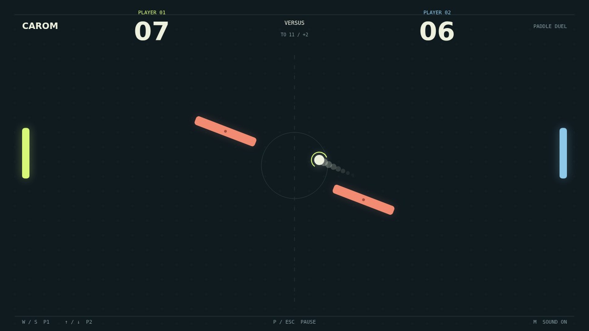

# Carom

Two paddles. Two obstacles. No straight answers. Carom is a quick, top-down duel about reading angles and making the next return your own. Take on the computer in Solo, or share a keyboard for a local Versus match.

The first serve gives you a moment to settle in. Then the rally starts: meet the ball in the middle of your paddle for a direct return, or catch it near an edge to send it high or low. Every paddle hit adds speed, turning a comfortable exchange into a test of timing.

Move through a hit and you put spin on the ball. Its glowing trail bends across the court as the spin fades. The coral obstacles sway and rotate together, opening lanes and closing others; a tilted face can turn your return into a bank shot your opponent never saw coming.

A point buys a breath, not a reset of the contest. The next serve goes toward the player who conceded it. Race to eleven, but keep a two-point lead: at ten-all, every read, every curve, and every last-second save matters.

